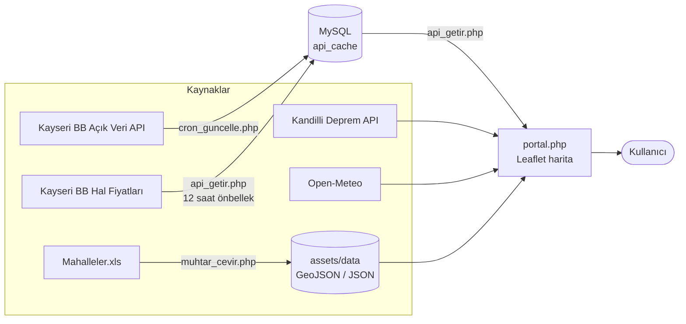

<div align="center">

#  Kayseri Şehir Portalı

### Kayseri'nin dijital ikizi, tek bir haritada.

Kandilli Rasathanesi, AFAD ve Kayseri Büyükşehir Belediyesi gibi kaynaklardan gelen açık verileri, 16 ilçe ve 711 mahalleyi kapsayan interaktif bir harita üzerinde buluşturan şehir rehberi.

<a href="http://kayserisehirportali.tr"></a>

<br />


-f59e0b?style=flat-square)


[Canlı Site](http://kayserisehirportali.tr) •
[Özellikler](#-özellikler) •
[Katmanlar](#%EF%B8%8F-harita-katmanları) •
[Mimari](#-mimari) •
[Kurulum](#-kurulum) •
[Veri Kaynakları](#-veri-kaynakları) •
[Yapı](#-proje-yapısı)

</div>

---

## 📸 Ekran Görüntüleri

<div align="center">

| Ana Sayfa | Şehir Portalı |
|:---:|:---:|
|  |  |

</div>

---

## ✨ Özellikler

- 🗺️ **İnteraktif harita:** Leaflet.js tabanlı harita motoruyla yüzlerce nokta akıcı biçimde görüntülenir.
- ⚡ **Dinamik filtreleme:** Sayfayı yenilemeden katmanlar arasında anında geçiş yapılır. Aktif ve planlanan hizmetler ayrı sekmelerde listelenir.
- 🔎 **Akıllı arama:** Türkçe karakterlerden bağımsız arama ve Nominatim ile Türkiye genelinde yer/adres arama.
- 🏘️ **İlçe ve mahalle sınırları:** Seçilen ilçe veya mahallenin sınırları haritada çizilir.
- 🧑‍💼 **Muhtarlık rehberi:** 711 mahallenin nüfus, alan ve muhtar iletişim bilgileri, ilçe bazlı listelenir.
- 📊 **İlçe istatistikleri:** 16 ilçenin cadde, sokak, bulvar, meydan ve küme sayıları.
- 🌋 **Canlı deprem takibi:** Kandilli verileriyle son depremler, şiddet ve derinlik bilgisiyle.
- 🚨 **Afet hazırlığı:** AFAD toplanma alanlarını kapasiteleriyle birlikte görme ve yol tarifi alma.
- 🥬 **Hal fiyatları:** Kayseri BB Yaş Sebze ve Meyve Hali fiyat listesi.
- 🕊️ **Vefat ilanları:** Taziye noktalarını haritada görme ve cenaze yerine yol tarifi alma.
- 🧭 **Tek tıkla navigasyon:** Seçilen noktaya Google Haritalar üzerinden yol tarifi.
- 🌤️ **Anlık hava durumu:** Open-Meteo ile Kayseri'nin güncel sıcaklığı.
- 🔄 **Otomatik veri senkronizasyonu:** Belediye API'leri cron ile çekilip veritabanında önbelleğe alınır, harita bu önbellekten beslenir.
- 👤 **Üyelik sistemi:** Kayıt, e-posta ile hesap doğrulama, giriş ve çıkış (`password_hash` ile güvenli şifre saklama).
- 📱 **Mobil uyumlu:** Tailwind CSS ile telefon, tablet ve masaüstünde düzgün çalışan arayüz.
- 🔗 **Derin bağlantılar:** `portal.php?hizmet=deprem` gibi adreslerle doğrudan istenen katmanı açma.

---

## 🗺️ Harita Katmanları

### ✅ Aktif Hizmetler (11)

| Katman | Açıklama | Kaynak |
|---|---|---|
| 🌋 **Son Depremler** | Canlı deprem akışı | Kandilli Rasathanesi |
| 🏕️ **Afet Toplanma Alanları** | Afet anında güvenli bölgeler ve kapasiteleri | AFAD & Açık Veri Portalı |
| 🏛️ **Tarihi Yerler** | Müze ve gezilecek yerler | İl Kültür Turizm Müdürlüğü |
| 🅿️ **Şehir Otoparkları** | Otopark konumları | Kayseri BB Açık Veri |
| 🛒 **Pazarlar** | Semt pazarı yerleri ve günleri | Kayseri BB Açık Veri |
| 💊 **Nöbetçi Eczaneler** | Güncel nöbetçi eczane listesi | Kayseri BB Açık Veri |
| 📶 **Ücretsiz Wi-Fi** | Belediye Wi-Fi noktaları | Kayseri BB Açık Veri |
| 🕊️ **Vefat İlanları** | Taziye noktaları ve mezarlık bilgisi | Kayseri BB Açık Veri |
| 🧑‍💼 **Mahalle/Muhtarlık Bilgileri** | 711 mahalle, muhtar ve nüfus bilgisi | Kayseri BB Açık Veri |
| 📊 **İlçe İstatistikleri** | 16 ilçenin cadde, sokak ve bulvar sayıları | Kayseri BB CBS |
| 🥬 **Hal Fiyatları** | Yaş sebze ve meyve hali fiyat listesi | Kayseri BB |

### 🚧 Planlanan / Kısıtlı Hizmetler (5)

| Katman | Durum |
|---|---|
| 📹 **Şehir Kameraları** | Konumlar haritada gösterilir. Canlı yayın KVKK kararı gereği kapalıdır. |
| 🚲 **KAYBİS İstasyonları** | Planlanıyor, veri entegrasyonu bekleniyor. |
| 💧 **Su Kesintileri** | Planlanıyor, veri entegrasyonu bekleniyor. |
| 🔌 **Elektrikli Şarj Noktaları** | Planlanıyor, veri entegrasyonu bekleniyor. |
| ⚽ **Spor Tesisleri ve Parklar** | Planlanıyor, veri entegrasyonu bekleniyor. |

---

## 🧩 Mimari

Veriler üç yoldan gelir: belediye API'leri cron ile MySQL önbelleğine alınır, hal fiyatları ayrı bir önbellekle sunulur, diğerleri ise doğrudan istemciden veya yerel veri dosyalarından okunur.



| Veri | Yol |
|---|---|
| Nöbetçi eczaneler, Wi-Fi noktaları, vefat ilanları | Cron → MySQL `api_cache` → `api/api_getir.php` → harita |
| Hal fiyatları | `api/api_getir.php` fiyat listesini çeker, 12 saat önbelleğe alır |
| Muhtarlar | `Mahalleler.xls` → `muhtar_cevir.php` → `assets/data/muhtarlar.json` |
| Depremler | Doğrudan istemciden Kandilli verisini sunan API |
| Otoparklar, pazarlar, toplanma alanları, tarihi yerler | `assets/data/` altındaki yerel GeoJSON/JSON dosyaları |
| İlçe ve mahalle sınırları | Nominatim (OpenStreetMap) |
| Hava durumu | Doğrudan istemciden Open-Meteo |

> [!NOTE]
> Vefat ilanlarındaki taziye adresleri, cron çalışırken Nominatim ile koordinata çevrilir. Adresi çözülemeyen ilanlar haritada gösterilmez.

---

## 🧰 Teknolojiler

| Alan | Teknoloji |
|---|---|
| **Backend** | PHP (PDO) |
| **Veritabanı** | MySQL / MariaDB |
| **E-posta** | [PHPMailer](https://github.com/PHPMailer/PHPMailer) (hesap doğrulama) |
| **Frontend** | HTML5, Vanilla JavaScript, [Tailwind CSS](https://tailwindcss.com/) (CDN) |
| **Harita** | [Leaflet.js](https://leafletjs.com/) 1.9.4, [OpenStreetMap](https://www.openstreetmap.org/) karoları |
| **Arama ve sınırlar** | [Nominatim](https://nominatim.openstreetmap.org/) (Geocoding) |
| **İkonlar** | [Font Awesome](https://fontawesome.com/) 6.4 |
| **Veri Formatı** | GeoJSON, JSON |

---

## 🚀 Kurulum

### Gereksinimler

- PHP 7.4 veya üzeri (`pdo_mysql`, `curl`, `mbstring` ve `dom` eklentileri açık)
- MySQL / MariaDB
- Apache / Nginx ya da XAMPP, WAMP, Laragon gibi yerel bir sunucu
- İnternet bağlantısı (harita karoları, CDN'ler ve canlı API'ler için)

### 1. Repoyu klonla

```bash
git clone https://github.com/sadecedqn/kayserisehirportali-WiP.git
cd kayserisehirportali-WiP
```

### 2. PHPMailer'ı ekle

Kayıt sırasında doğrulama e-postası gönderildiği için PHPMailer gerekir. `Exception.php`, `PHPMailer.php` ve `SMTP.php` dosyalarını proje kökündeki `phpmailer/` klasörüne koy.

### 3. Veritabanını oluştur

Aşağıdaki tablolar kodun kullandığı alanlara göre hazırlanmış örnek şemadır:

<details>
<summary><b>📄 Örnek SQL şeması</b></summary>

```sql
CREATE TABLE users (
    id                 INT AUTO_INCREMENT PRIMARY KEY,
    full_name          VARCHAR(150) NOT NULL,
    email              VARCHAR(190) NOT NULL UNIQUE,
    password_hash      VARCHAR(255) NOT NULL,
    verification_token VARCHAR(64)  NULL,
    is_verified        TINYINT(1)   NOT NULL DEFAULT 0
) CHARACTER SET utf8mb4;

CREATE TABLE api_cache (
    endpoint_name VARCHAR(100) PRIMARY KEY,
    json_data     LONGTEXT NOT NULL
) CHARACTER SET utf8mb4;
```

</details>

### 4. Bağlantı ayarlarını yap

`config/baglan.php` dosyasında kendi veritabanı bilgilerini gir:

```php
$host     = 'localhost';
$dbname   = 'VERITABANI_ADI';
$username = 'KULLANICI_ADI';
$password = 'SIFRE';
```

E-posta (SMTP) ayarlarını da kendi sunucuna göre `auth/kayit.php` içinde düzenle.


```gitignore
config/baglan.php
api/hal_cache.json
```

### 5. Muhtar verisini oluştur

Muhtar rehberi `assets/data/muhtarlar.json` dosyasını kullanır. Bu dosya, `Mahalleler.xls` dosyasından üretilir. Tarayıcıdan `muhtar_cevir.php` sayfasını **bir kez** aç:

```
http://localhost:8000/muhtar_cevir.php
```

Ekranda "Harika! muhtarlar.json dosyası tüm detaylarıyla güncellendi" mesajını görürsen dosya hazırdır. İşlem bittikten sonra bu dosyayı sunucudan silmen ya da erişimi kapatman önerilir.

### 6. Verileri ilk kez çek

```bash
php api/cron_guncelle.php
```

> [!NOTE]
> `api/` klasörü yazılabilir olmalıdır. Hal fiyatları için `api/hal_cache.json` önbellek dosyası burada oluşturulur.

### 7. Otomatik güncellemeyi kur

Verilerin 5 dakikada bir yenilenmesi için sunucunda cron tanımla:

```cron
*/5 * * * * php /yol/kayserisehirportali-WiP/api/cron_guncelle.php
```

### 8. Çalıştır

```bash
php -S localhost:8000
```

Tarayıcıda `http://localhost:8000` adresini aç.

> [!NOTE]
> Proje PHP içerdiği için dosyalara çift tıklayarak açılmaz. Bir PHP sunucusu üzerinden çalıştırılmalıdır.

---

## 🔗 Doğrudan Katman Bağlantıları

Portal, `hizmet` parametresiyle istenen katmanı otomatik açar:

| Adres | Açılan Katman |
|---|---|
| `portal.php?hizmet=deprem` | Son Depremler |
| `portal.php?hizmet=toplanma_alanlari` | Afet Toplanma Alanları |
| `portal.php?hizmet=gezilecek_yerler` | Tarihi Yerler |
| `portal.php?hizmet=otoparklar` | Şehir Otoparkları |
| `portal.php?hizmet=pazar_yerleri` | Pazarlar |
| `portal.php?hizmet=nobetci_eczane` | Nöbetçi Eczaneler |
| `portal.php?hizmet=wifi_noktalari` | Ücretsiz Wi-Fi |
| `portal.php?hizmet=vefat` | Vefat İlanları |
| `portal.php?hizmet=muhtar` | Mahalle/Muhtarlık Bilgileri |
| `portal.php?hizmet=cadde_sokak` | İlçe İstatistikleri |
| `portal.php?hizmet=hal` | Hal Fiyatları |
| `portal.php?hizmet=kameralar` | Şehir Kameraları (kısıtlı) |

Parametre verilmezse tüm katmanlar listelenir (`tumu`).

---

## 📂 Proje Yapısı

```
📦 kayserisehirportali-WiP
├── 📄 index.php                # Karşılama sayfası (hero harita, hizmetler, veri kaynakları)
├── 📄 portal.php               # Tam ekran interaktif şehir portalı (harita ve arayüz mantığı)
├── 📄 muhtar_cevir.php         # Mahalleler.xls dosyasından muhtarlar.json üretir
│
├── 📁 api/
│   ├── 📄 api_getir.php        # Önbellekteki veriyi JSON olarak sunar, hal fiyatlarını çeker
│   └── 📄 cron_guncelle.php    # Belediye API'lerinden veriyi çekip veritabanına yazar
│
├── 📁 auth/
│   ├── 📄 giris.php            # Kullanıcı girişi
│   ├── 📄 kayit.php            # Kayıt + doğrulama e-postası
│   ├── 📄 onay.php             # E-posta doğrulama bağlantısı
│   └── 📄 cikis.php            # Oturumu kapatma
│
├── 📁 config/
│   └── 📄 baglan.php           # Veritabanı bağlantısı ve oturum ayarları
│
├── 📁 phpmailer/               # PHPMailer kütüphanesi (kurulum 2. adım)
│
└── 📁 assets/
    ├── 📄 style.css            # Özel stiller
    ├── 📁 icons/               # Logolar ve kurum/katman görselleri
    └── 📁 data/                # Yerel veri setleri
        ├── 📄 Mahalleler.xls                               # Mahalle ve muhtar kaynak tablosu
        ├── 📄 muhtarlar.json                               # muhtar_cevir.php ile üretilir
        ├── 📄 kayseri-gezilecek-yerler.json
        ├── 📄 otoparklar-456371.geojson.txt
        ├── 📄 pazar_yeri-4932711.geojson.txt
        └── 📄 toplanma-alanlari_alan-3829284.geojson.txt
```

---

## 📡 Veri Kaynakları

Bu proje, veriyi kendisi üretmez. Aşağıdaki kaynaklardan gelen açık verileri görselleştirir:

- 🏛️ **Kayseri Büyükşehir Belediyesi Açık Veri Portalı** (eczane, Wi-Fi, vefat, muhtar, hal fiyatları)
- 🌋 **Kandilli Rasathanesi** (deprem verileri, [Orhan Aydoğdu Deprem API](https://api.orhanaydogdu.com.tr) üzerinden)
- 🚨 **AFAD** (toplanma alanları)
- 🎭 **İl Kültür ve Turizm Müdürlüğü** (tarihi yerler)
- 🌤️ **[Open-Meteo](https://open-meteo.com/)** (hava durumu)
- 🗺️ **[OpenStreetMap](https://www.openstreetmap.org/copyright)** katkıcıları (harita, arama ve sınırlar)

> [!IMPORTANT]
> Verilerin güncelliği ve doğruluğu ilgili kurumların API'lerine bağlıdır. Acil durumlarda resmi kurumların kanallarını esas alın.

---

## 🗺️ Yol Haritası

- [ ] KAYBİS istasyonları için veri entegrasyonu
- [ ] Su kesintileri (KASKİ) entegrasyonu
- [ ] Elektrikli araç şarj noktaları
- [ ] Spor tesisleri ve parklar katmanı
- [ ] Koyu tema desteği

---

## 🤝 Katkıda Bulunma

Katkılar memnuniyetle karşılanır.

1. Repoyu fork'la
2. Yeni bir dal oluştur (`git checkout -b yeni-ozellik`)
3. Değişikliklerini commit'le (`git commit -m "Yeni özellik eklendi"`)
4. Dalını push'la (`git push origin yeni-ozellik`)
5. Pull Request aç

---

## 📜 Lisans

Bu proje [MIT Lisansı](LICENSE) ile lisanslanmıştır.

---

<div align="center">

**Açık veri felsefesini desteklemek amacıyla geliştirilmiştir.** 💙

Beğendiysen repoya ⭐ vermeyi unutma!

</div>
